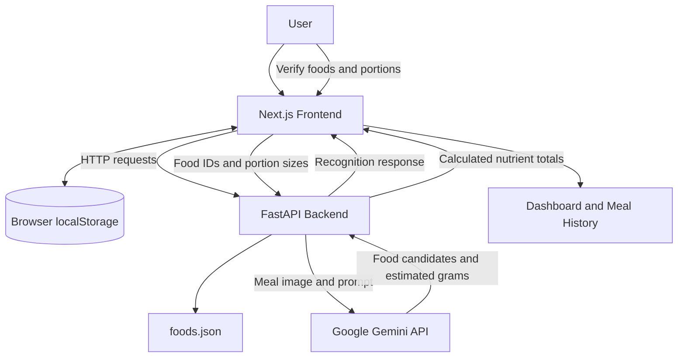

# Earthy — AI-Assisted Personalized Nutrition

Earthy is an AI-assisted nutrition-tracking web application designed to help users understand their food intake through meal logging, photo-based food recognition, and nutrient estimation.

Users can maintain a basic nutrition profile, record meals, review estimated nutrient intake, and explore their food history. Earthy combines AI-assisted food identification with deterministic nutrition calculations based on a local food dataset.

**Project status:** Hackathon prototype in active development.

## Table of Contents

- [Problem Statement](#problem-statement)
- [Our Solution](#our-solution)
- [Features](#features)
- [How It Works](#how-it-works)
- [Technology Stack](#technology-stack)
- [Architecture](#architecture)
- [Project Structure](#project-structure)
- [Getting Started](#getting-started)
- [Environment Variables](#environment-variables)
- [API Endpoints](#api-endpoints)
- [Sample Nutrition Calculation](#sample-nutrition-calculation)
- [Testing](#testing)
- [Data and Accuracy](#data-and-accuracy)
- [Security and Privacy](#security-and-privacy)
- [Known Limitations](#known-limitations)
- [Future Improvements](#future-improvements)
- [Contributing](#contributing)
- [License](#license)

## Problem Statement

Understanding nutritional intake can be difficult when food logging is time-consuming, nutritional information is unfamiliar, and commonly used food databases do not adequately reflect everyday regional meals.

Many people know what they eat but may not know how their meals contribute to their overall nutrient intake.

Earthy aims to make food logging more accessible by combining photo-assisted meal identification with understandable nutrition estimates and a food dataset that can be expanded with regionally relevant foods.

## Our Solution

Earthy follows a hybrid approach:

1. **AI-assisted recognition:** A user uploads a meal photo, and Google Gemini suggests visible food items and estimated portion sizes.
2. **User verification:** The user reviews the recognized foods and corrects food choices or portion estimates before relying on the results.
3. **Deterministic calculations:** The backend maps supported foods to a local dataset and calculates nutrients based on their recorded values and portion sizes.
4. **Nutrition tracking:** The frontend presents the resulting estimates and provides dashboard and meal-history views.

AI identifies possible foods; it does not independently determine authoritative nutritional values. Nutrient calculations use the application's dataset.

## Features

### User Profile
- Record basic profile information, including age, sex, height, weight, activity level, dietary preference, and budget.
- Store profile information locally in the browser.

### Meal Logging
- Log supported food items and their portions.
- Upload meal photos for AI-assisted food recognition.
- Review suggested foods and estimated portions.
- Calculate estimated nutrient totals for supported ingredients.

### Nutrition Dashboard
- Review nutrition information derived from logged meals.
- Explore available nutrient summaries.

### Food History
- Review previously recorded meals stored by the application.

### Nutrition Calculation API
- Retrieve available food records.
- Look up individual foods.
- Calculate nutrient totals using portion sizes and dataset values.

### AI-Powered Photo Analysis
- Send a meal image to the backend.
- Receive candidate food names, estimated edible portion weights, and confidence labels.
- Require user verification because image recognition and portion estimates can be inaccurate.

## How It Works

### 1. Meal photo recognition

The frontend uploads an image to the FastAPI backend. The backend sends the image to Google Gemini, which returns structured candidate food names and estimated portions.

These estimates are suggestions, not measurements.

### 2. Food matching and verification

The application attempts to match recognized food names to supported food records. Users should verify the food selection and portion size, especially when a dish contains multiple ingredients or a preparation method changes its nutritional composition.

Foods that cannot be matched should be selected or corrected manually where the interface supports it.

### 3. Nutrition calculation

For supported foods, the backend uses nutrient values from `frontend/data/foods.json`.

For a nutrient recorded per 100 grams:

`Nutrient amount = (Nutrient value per 100 g × Portion in grams) / 100`

The backend calculates the nutrient contribution of each ingredient and aggregates the totals.

### 4. Tracking

The frontend stores profile and meal-history information in browser `localStorage`. This allows the information to persist in the same browser, but it is not a cloud database or a cross-device account system.

## Technology Stack

| Component | Technology |
|---|---|
| Frontend | Next.js, React, TypeScript |
| Styling | CSS and CSS Modules |
| Backend | Python, FastAPI |
| Request validation | Pydantic |
| AI food recognition | Google Gemini API |
| AI SDK | `google-genai` |
| Nutrition dataset | Local JSON |
| Local persistence | Browser `localStorage` |
| API documentation | FastAPI / Swagger UI |
| Testing | Pytest and FastAPI TestClient |

## Architecture



For the detailed architecture, API request and response formats, data flows, and design limitations, see [`docs/ARCHITECTURE.md`](docs/ARCHITECTURE.md).

## Project Structure

```text
earthy/
├── README.md
├── LICENSE
├── .gitignore
├── docs/
│   ├── ARCHITECTURE.md
│   └── TESTING.md
├── backend/
│   ├── main.py
│   ├── requirements.txt
│   ├── requirements-dev.txt
│   ├── .env.example
│   └── tests/
│       ├── conftest.py
│       └── test_api.py
└── frontend/
    ├── app/
    │   ├── page.tsx
    │   ├── profile/
    │   ├── dashboard/
    │   ├── log-meal/
    │   └── history/
    ├── data/
    │   └── foods.json
    └── lib/
        └── nutrition.ts
```

This is the intended documentation and test layout. If a listed documentation or test file has not yet been added to the repository, create it before claiming that it is present.

## Getting Started

### Prerequisites

Install the following:

- Git
- Node.js and npm
- Python 3.11 or newer recommended
- A Google AI Studio API key for Gemini-powered photo analysis

### 1. Clone the repository

```bash
git clone https://github.com/keshabag/earthy.git
cd earthy
```

### 2. Set up the backend

From the repository root:

```bash
cd backend
python -m venv .venv
source .venv/bin/activate
python -m pip install --upgrade pip
pip install -r requirements.txt
```

Create a local environment file:

```bash
cp .env.example .env
```

Open `backend/.env` and add your own Gemini API key:

```dotenv
GEMINI_API_KEY=your_actual_api_key
GEMINI_MODEL=gemini-3.8-flash
```

Replace the placeholder with your own valid key. Never publish your API key or commit `backend/.env` to GitHub.

Start the backend from the `backend/` directory:

```bash
uvicorn main:app --reload --port 8000
```

The backend should now be available at:

- API root: http://127.0.0.1:8000/
- Health check: http://127.0.0.1:8000/health
- Interactive API documentation: http://127.0.0.1:8000/docs

Keep this terminal running.

### 3. Set up the frontend

Open a second terminal and navigate to the repository:

```bash
cd ~/Documents/zindagi/earthy/frontend
npm install
npm run dev
```

Open the application in your browser:

**http://localhost:3000**

Keep both the frontend and backend running while testing the application.

### 4. Verify the setup

Check that:

1. The frontend opens at `http://localhost:3000`.
2. The backend health endpoint responds at `http://127.0.0.1:8000/health`.
3. The food-list endpoint returns the available food records.
4. Nutrition calculations work for supported foods.
5. Photo recognition works when the Gemini API key, model configuration, network, and API quota permit it.

The backend expects the food dataset at `frontend/data/foods.json`. Preserve the repository's folder structure unless you also update the backend's dataset path.

## Environment Variables

| Variable | Required | Description |
|---|---|---|
| `GEMINI_API_KEY` | Yes for the current backend startup | Secret key used to authenticate Gemini API requests. |
| `GEMINI_MODEL` | Optional | Gemini model identifier. The current backend defaults to `gemini-3.8-flash`. |

The backend currently initializes the Gemini client during application startup, so the API key is expected even when testing endpoints that do not call Gemini.

Use `backend/.env.example` as the template. Keep actual credentials in `backend/.env`, which must remain excluded from version control.

If the frontend or backend is deployed, configure the API base URL and CORS origins for the deployed environment rather than using local development addresses.

## API Endpoints

| Method | Endpoint | Purpose |
|---|---|---|
| `GET` | `/` | API welcome/status response |
| `GET` | `/health` | Health check |
| `GET` | `/foods` | Retrieve supported foods |
| `GET` | `/foods/{food_id}` | Retrieve a food by ID |
| `POST` | `/nutrition/calculate` | Calculate nutrients for ingredient portions |
| `POST` | `/meals/analyze-photo` | Identify candidate foods from an uploaded image using Gemini |

### Nutrition calculation request

The following is an example of the request structure. The food IDs must match records in the current dataset.

```json
{
  "ingredients": [
    {
      "food_id": "roti",
      "grams": 60
    },
    {
      "food_id": "dal",
      "grams": 150
    }
  ]
}
```

The response contains ingredient-level nutrition estimates and aggregate totals for the nutrients supported by the dataset.

### Photo analysis

The `/meals/analyze-photo` endpoint accepts an image in a multipart form field named `photo`. The backend validates the upload and asks Gemini to return candidate food names, estimated portions, confidence labels, and a flag indicating that user verification is required.

See the live API documentation at `/docs` for the actual request and response schemas.

## Sample Nutrition Calculation

To test the calculation endpoint while the backend is running, use:

```bash
curl -X POST http://127.0.0.1:8000/nutrition/calculate \
  -H "Content-Type: application/json" \
  -d '{
    "ingredients": [
      {"food_id": "roti", "grams": 60},
      {"food_id": "dal", "grams": 150}
    ]
  }'
```

If the example IDs differ from the current dataset, first inspect `GET /foods` and substitute valid IDs.

The returned totals are calculated from the dataset; they are not AI-generated nutrient guesses.

## Testing

The backend can be tested using Pytest and FastAPI's test client.

After installing the backend requirements and development requirements, run:

```bash
python -m pytest backend/tests -v
```

The intended automated test coverage includes:

- Health endpoint behavior.
- Food-list and individual-food retrieval.
- Unknown food IDs.
- Nutrition calculations for valid portions.
- Empty ingredient lists.
- Zero or negative portion sizes.
- Invalid or empty image uploads.

Automated tests should not require a live Gemini API request. Photo recognition should also be tested manually with a configured key because model availability, quotas, and network conditions can vary.

See [`docs/TESTING.md`](docs/TESTING.md) for testing instructions and coverage.

## Data and Accuracy

Earthy's current dataset is a small starter dataset located at `frontend/data/foods.json`. It includes a limited selection of everyday foods and values for nutrients such as:

- Energy
- Protein
- Iron
- Calcium
- Fibre

The dataset is not a comprehensive food-composition database. Values should be reviewed against reliable sources, with the source, units, preparation method, and assumptions documented before expanding the application.

Photo recognition cannot reliably determine exact weights, hidden ingredients, oil quantities, recipes, or cooking methods from an image alone. User verification is therefore an important part of the workflow.

**Earthy does not provide clinically validated nutrient assessments or medical advice.** Nutrition estimates should be interpreted as informational approximations.

## Security and Privacy

- Never commit `.env` files, API keys, or other secrets.
- Keep the Gemini API key exclusively on the server.
- Do not expose the API key through client-side code or `NEXT_PUBLIC_` variables.
- Meal images sent for recognition are transmitted to the configured AI service; consider applicable provider data-handling policies before uploading personal images.
- The current application uses browser `localStorage` rather than authenticated accounts or server-side storage.
- Anyone with access to the same browser profile may be able to access its locally stored data.
- Before public deployment, review CORS configuration, API usage limits, error handling, and the privacy implications of image uploads.

## Known Limitations

- The supported food dataset is small.
- Food-photo recognition and portion-size estimates may be incorrect.
- AI-detected foods may not match the available dataset.
- The application does not yet have server-side user accounts or cross-device synchronization.
- A multi-day rolling nutrient analysis and comprehensive nutrient-gap detection are not guaranteed by the current implementation.
- Recommendations are not a substitute for advice from a qualified healthcare professional.
- The current local-development API configuration must be adapted for production deployment.

## Future Improvements

- Expand the food database using reliable, appropriately licensed Indian food-composition data.
- Improve food-name normalization and matching between Gemini results and dataset IDs.
- Add user-editable ingredient and portion verification.
- Introduce multi-day nutrient summaries and transparent nutrient-gap heuristics.
- Add persistent accounts and secure server-side storage.
- Add broader frontend, backend, and integration tests.
- Configure production hosting, environment-specific CORS, and monitoring.
- Improve accessibility, mobile usability, and error feedback.

These items are planned improvements and should not be interpreted as already implemented features.

## Contributing

Contributions, bug reports, and suggestions are welcome.

1. Fork the repository.
2. Create a feature branch.
3. Make your changes and add appropriate tests.
4. Run the available test suite.
5. Submit a pull request describing the changes.

When modifying nutrition data, document the source, units, preparation assumptions, and licensing conditions.

## License

This project is released under the MIT License. See the [`LICENSE`](LICENSE) file for details.
