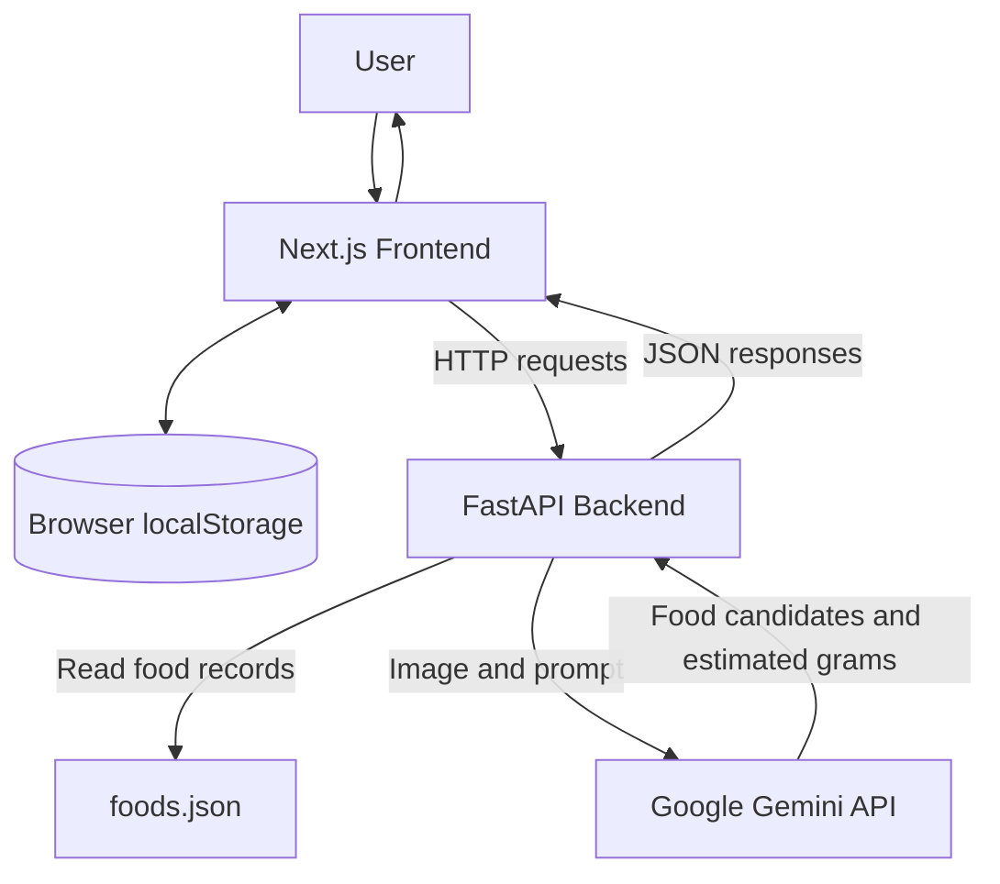
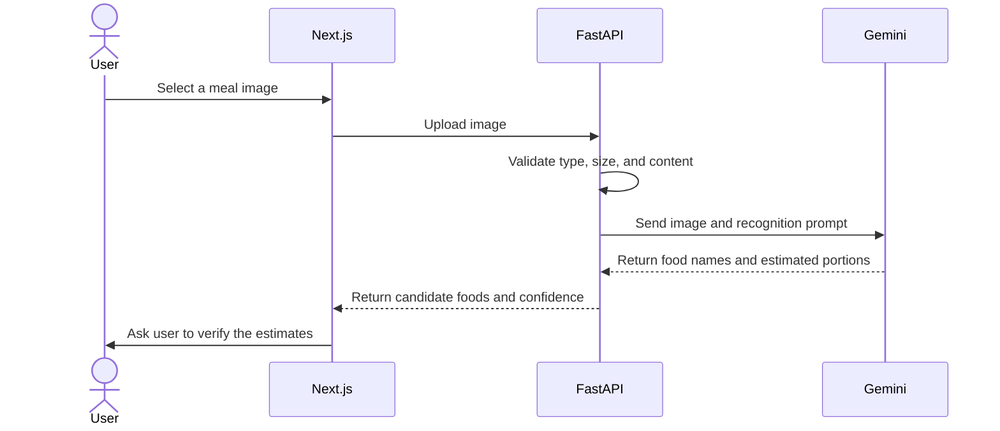
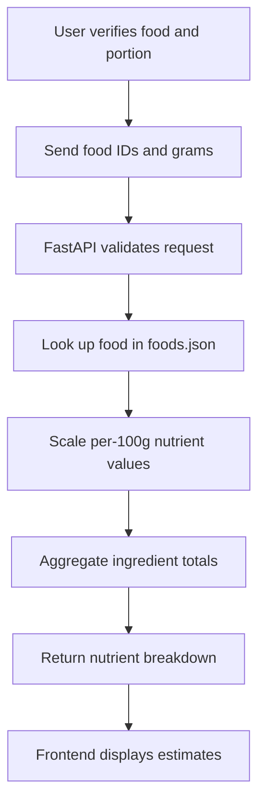

# Earthy — Technical Design Document

## 1. Overview

Earthy is an AI-assisted nutrition-tracking web application. It combines a Next.js frontend, a FastAPI backend, a local JSON food dataset, and Google Gemini for image-based food recognition.

The system separates AI-assisted identification from deterministic nutrition calculations. Gemini suggests food names and estimated portions, while the backend calculates nutrient totals using the application's dataset.

**Current status:** Hackathon prototype. The application does not provide clinically validated nutrition assessments or medical advice.

## 2. System Architecture



### Components

| Component | Responsibility |
|---|---|
| Next.js frontend | User profile, meal logging, dashboard, and food history |
| Browser localStorage | Stores the user's profile and meal history locally |
| FastAPI backend | Validates API requests, serves food records, calculates nutrients, and handles photo analysis |
| `frontend/data/foods.json` | Stores the supported foods and their nutrient values |
| Google Gemini API | Identifies candidate foods and estimates portions from meal images |

## 3. Technology Stack

- Frontend: Next.js, React, TypeScript, CSS
- Backend: Python, FastAPI, Pydantic
- AI integration: Google Gemini API using `google-genai`
- Dataset: JSON
- Local persistence: Browser `localStorage`
- API testing: Pytest and FastAPI TestClient

## 4. Photo Recognition Workflow



The photo-analysis endpoint accepts an image through the `photo` multipart form field. The backend checks the upload before sending it to Gemini.

The resulting food names and portion weights are estimates. Users should correct the results before using them for nutrition tracking.

## 5. Nutrition Calculation Workflow



For a nutrient value recorded per 100 grams, the backend uses:

`Calculated amount = value per 100 g × portion grams / 100`

The backend calculates totals from the dataset rather than asking the AI model to invent nutritional values.

Unknown food IDs result in an HTTP 404 response. Invalid portion sizes are rejected by request validation.

## 6. API Design

| Method | Endpoint | Purpose |
|---|---|---|
| GET | `/` | API welcome/status response |
| GET | `/health` | Health check |
| GET | `/foods` | Retrieve all supported foods |
| GET | `/foods/{food_id}` | Retrieve one food by ID |
| POST | `/nutrition/calculate` | Calculate nutrient totals |
| POST | `/meals/analyze-photo` | Analyze a meal image using Gemini |

### Nutrition request example

```json
{
  "ingredients": [
    {"food_id": "roti", "grams": 60},
    {"food_id": "dal", "grams": 150}
  ]
}
```

The IDs must match the actual records in `frontend/data/foods.json`. The response contains the ingredient-level nutrient breakdown and aggregate totals.

### Photo-analysis response

The photo-analysis endpoint returns a list of candidate foods with their names, estimated gram amounts, confidence labels, and a flag indicating that user verification is required.

Refer to the running FastAPI documentation at `/docs` for the exact schemas.

## 7. Data Management

The backend reads the food dataset from `frontend/data/foods.json`.

The current application stores profile and meal-history data in browser `localStorage`, using the keys:

- `earthy-profile`
- `earthy-meals`

This design supports persistence in the same browser but does not provide server-side accounts, cross-device synchronization, or centralized backups of user meal history.

## 8. Configuration and Deployment

The backend uses these environment variables:

| Variable | Purpose |
|---|---|
| `GEMINI_API_KEY` | Authenticates requests to Gemini |
| `GEMINI_MODEL` | Selects the Gemini model |

The API key must remain server-side and must not be committed to Git.

For local development, the frontend and backend run on separate ports. The backend's CORS configuration permits the configured local frontend origins. A production deployment must add the deployed frontend's exact origin and update the frontend API URL.

The backend also expects the food dataset to remain at the path resolved relative to the repository structure.

## 9. Security and Reliability

- Keep API credentials out of source control.
- Validate uploaded images and reject empty or unsupported files.
- Handle temporary AI service failures gracefully.
- Treat photo-derived food names and weights as uncertain estimates.
- Avoid logging secrets or unnecessary personal data.
- Do not treat a successful health check as proof that Gemini is available.
- Remember that browser `localStorage` is not a secure user-account database.

## 10. Known Limitations

- The current food dataset is small and does not cover all regional foods or recipes.
- Portion estimates from images may be inaccurate.
- AI-recognized foods may not match an existing dataset entry.
- Meal history is stored locally rather than in a server-side database.
- Nutrient-gap detection and personalized recommendations require further development and validation.
- The application is a prototype and is not intended to diagnose or treat health conditions.

## 11. Future Work

1. Expand the food dataset using reliable and appropriately licensed food-composition sources.
2. Improve food-name normalization and dataset matching.
3. Add multi-day nutrient summaries and transparent recommendation rules.
4. Introduce secure accounts and server-side persistence.
5. Add broader frontend and integration tests.
6. Configure production hosting, environment-specific settings, and monitoring.
